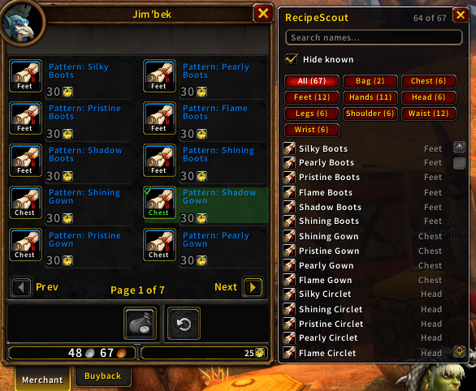
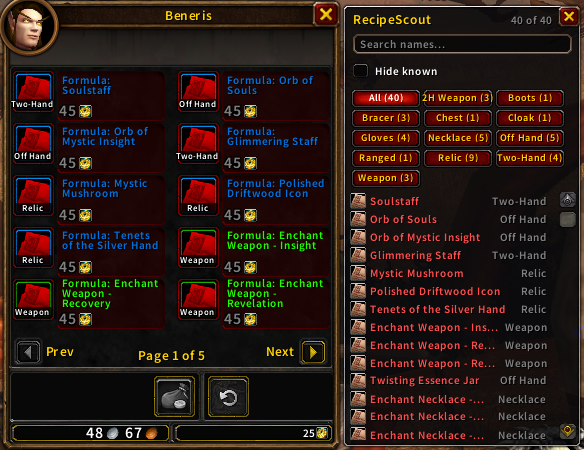
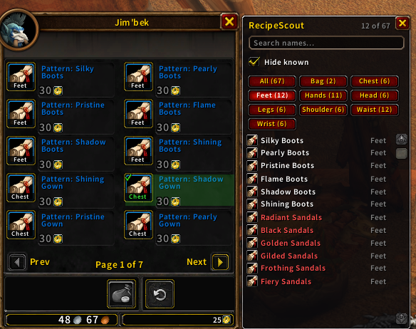
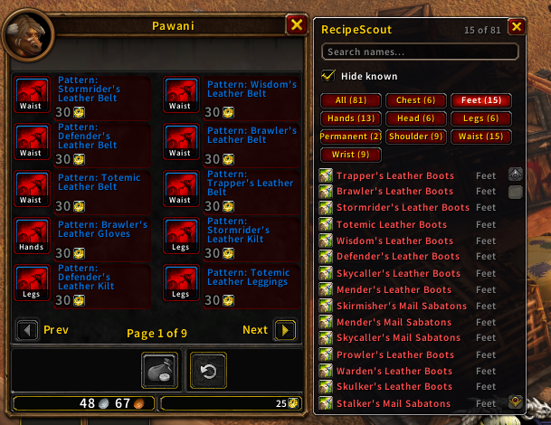
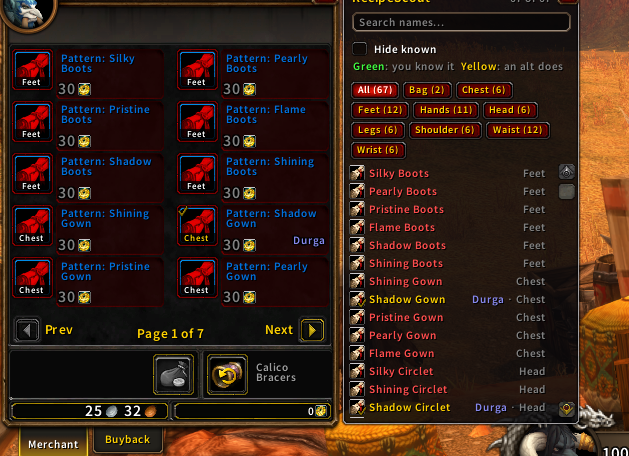

# RecipeScout

**Which of these 70 patterns are boots?** RecipeScout labels every recipe a merchant sells with what it makes, marks the ones you or your alts already know, and lets you filter all pages at once.

## What you see

- **A slot on every recipe icon:** `Feet`, `Chest`, `Waist`, `Two-Hand`, `Off Hand`, `Relic`… or the item type for things you don't wear (`Reagent Bag`). Enchanting formulas show what they enchant, using the same slot names (`Weapon`, `Wrist`, `Feet`), so the Feet filter finds boot enchants too.
- **Known recipes:** green check on the icon and a green row.
- **Can't learn yet** (skill too low, reputation): stays red, as the game already shows.

## The side panel

Opens next to any merchant that sells recipes:

- slot buttons with counts: `Feet (12)`, `Hands (11)`…
- name search and **Hide known**
- every match from **all pages** in one list; hover for the tooltip, click to jump to its page

Close it with the X; the **Recipes** button on the merchant brings it back. `/rs` prints every recipe on the merchant in chat.

## Your alts

Open each crafter's profession window once and RecipeScout remembers what they know, across your whole account.

- **Yellow** recipe = one of your other characters already knows it, with their name next to the price (`Durga`, or `Durga +1` when several do) and in the panel (`Durga · Chest`).
- The recipe **tooltip** lists who knows it, who can learn it right now, and who has the profession but not enough skill. Works on merchants, in bags and at the auction house.
- `/rs alts` lists your characters and their recipe counts; `/rs forget <name>` removes one.

## Plays nicely

- Works with every profession and every recipe merchant.
- Reads the game's own item data: no recipe database to go out of date, and labels follow your game language.
- Only adds its own labels and panel; never hides or moves merchant items, so tooltip, profession and known-item addons keep working.

Source and issues: [github.com/jlblancolb/recipe-scout](https://github.com/jlblancolb/recipe-scout)
